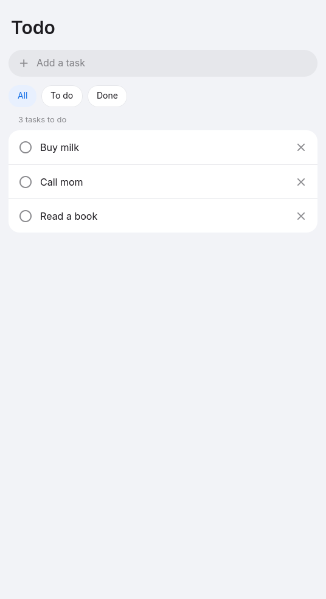
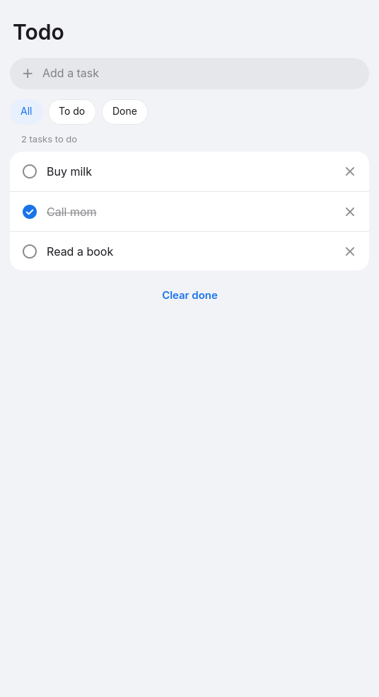
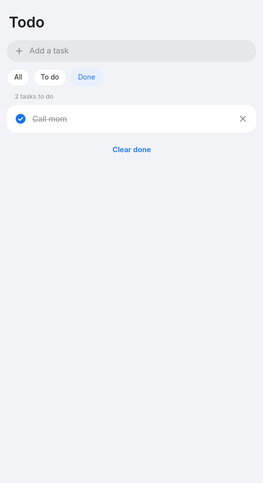
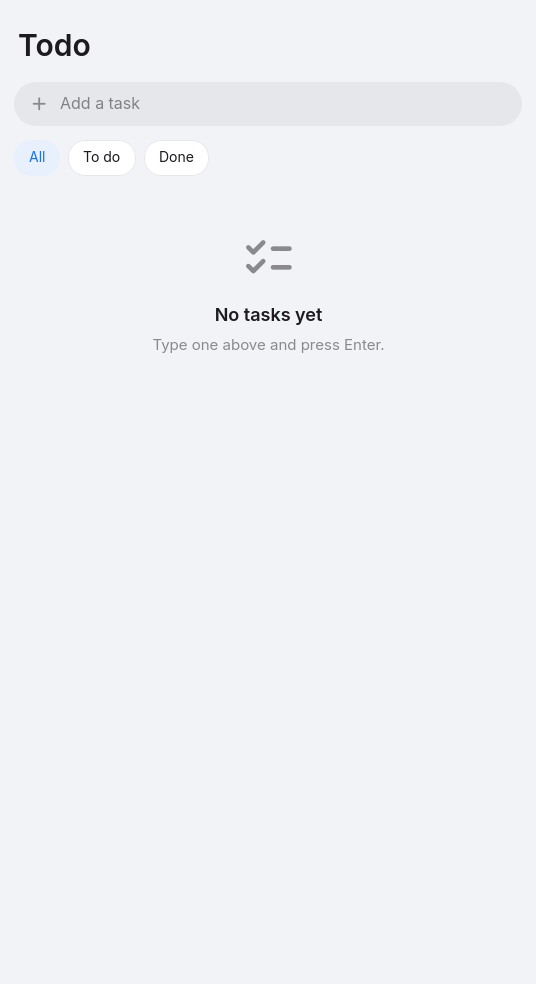
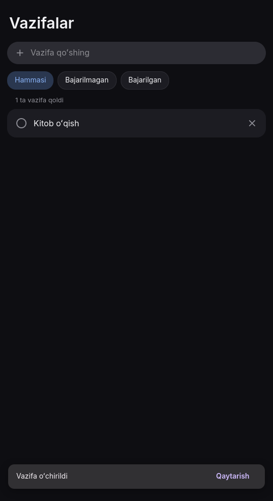
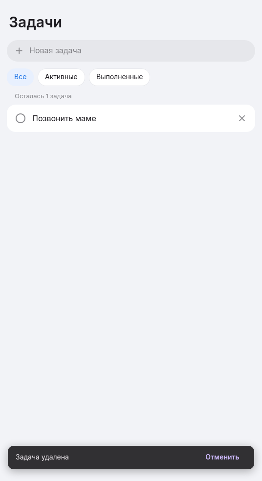
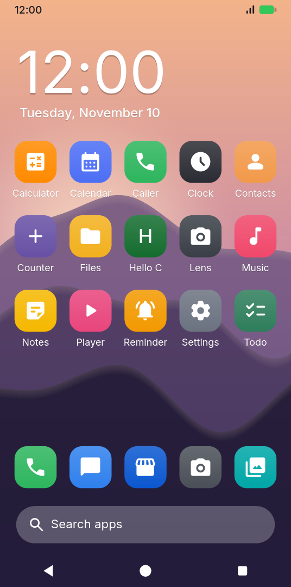
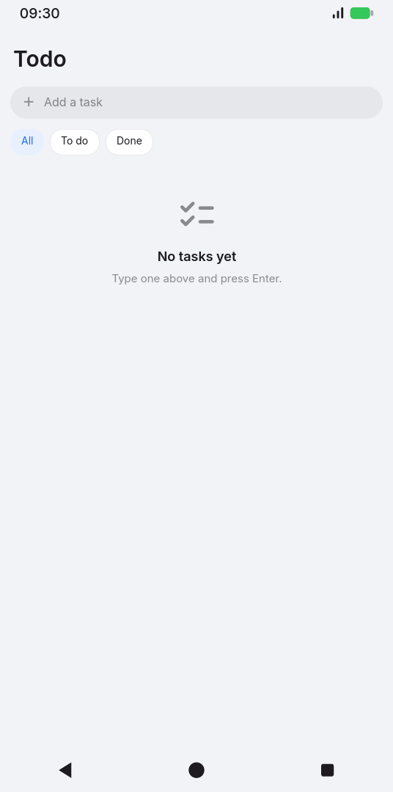

# Todo

A Bek OS app written in **Python**: a list of things to do, as a phone's
to-do apps keep one.

- A task is typed into the field at the top and added with Enter.
- A tap on a task ticks it off (its words struck through), and ticks it on
  again.
- The chips show every task, those still to do, or those done; the caption
  says how many are left.
- A task's cross, or a swipe either way, deletes it; Clear done deletes
  every task done. The snackbar's Undo puts back what went, for four
  seconds.

<table>
  <tr>
    <td align="center"><br>Tasks added</td>
    <td align="center"><br>One ticked off</td>
    <td align="center"><br>The Done filter</td>
    <td align="center"><br>Nothing yet</td>
  </tr>
  <tr>
    <td align="center"><br>Swiped away (Uzbek, dark)</td>
    <td align="center"><br>Deleted (Russian)</td>
    <td align="center"><br>On the phone's home</td>
    <td align="center"><br>Open on the phone</td>
  </tr>
</table>

The screenshots are its headless tests' (`bek-app test`) and the phone's
own test's, in QEMU.

The tasks are kept in the app's storage (`needs = ["storage"]`) under one
key, as JSON. Its words are in English, Uzbek and Russian (`i18n/`), with
each language's plurals; its look is Bek UI's, in the system's tokens, light
and dark.

It is built by [componentize-py](https://github.com/bytecodealliance/componentize-py),
which makes `src/app.py` and the modules it imports a WebAssembly component
of the phone's world, CPython carried in it (about 18 MB). The phone gives
it its page (`dom`), its words (`words`), its own files (`resources`) and its
storage (`host-api`); `bek-app` writes the world for componentize-py at each
build.

```sh
pip install componentize-py==0.25.1      # once
bek-app build            # target/bek/todo.wasm
bek-app preview          # on this computer, as the phone shows it
bek-app test             # its headless tests (tests/*.toml)
python3 tests/test_tasks.py              # the tasks' own rules
```

| Path | What |
| --- | --- |
| `src/app.py` | The app: its state, what each event does, the snackbar's time |
| `src/tasks.py` | The tasks: adding, ticking off, filters, deleting and putting back, and their JSON |
| `src/page.py` | The page's parts, and a row for each task shown |
| `src/words.py` | Its words in the phone's language, and the markup's put in |
| `src/store.py` | The tasks as the storage keeps them |
| `ui/` | Its page (`main.html`) and its look (`style.css`) |
| `docs/screenshots/` | The screenshots above |
| `tests/` | Headless tests (adding; ticking off, filters and Clear done; a swipe in Uzbek, dark; the cross in Russian) and the tasks' unit tests |
